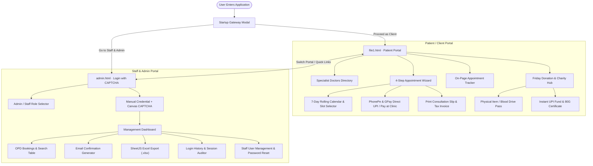

# 🏥 The Uni Clinic · Uni Health Center Management System

[](https://developer.mozilla.org/en-US/docs/Web/HTML)
[](https://developer.mozilla.org/en-US/docs/Web/CSS)
[](https://developer.mozilla.org/en-US/docs/Web/JavaScript)
[](LICENSE)

A complete, responsive web application for university outpatient healthcare, specialist doctor appointment scheduling, patient tracking, charity donation drives, and administrative management. Built entirely with vanilla modern web technologies (HTML5, CSS3, JavaScript, Canvas API, and HTML5 Web Storage) without external heavy frameworks.

---

## 📌 Table of Contents

- [Overview](#-overview)
- [System Architecture](#-system-architecture)
- [Key Features](#-key-features)
  - [1. Patient & Client Portal (`file1.html`)](#1-patient--client-portal-file1html)
  - [2. Staff & Admin Management Portal (`admin.html`)](#2-staff--admin-management-portal-adminhtml)
- [Credentials Reference](#-credentials-reference)
- [Project Directory Structure](#-project-directory-structure)
- [Getting Started & Local Setup](#-getting-started--local-setup)
- [Security & Validation Mechanisms](#-security--validation-mechanisms)
- [Clinic Location & Contact](#-clinic-location--contact)
- [License](#-license)

---

## 🌐 Overview

**The Uni Clinic (Uni Health Center)** is designed to provide students, faculty, and local residents in Phagwara, Punjab, with an intuitive digital healthcare experience. 

The application offers two distinct, seamlessly interconnected portals:
1. **Patient / Client Portal (`file1.html`)**: For exploring medical specialties, booking live doctor consultation slots, tracking confirmed appointments, obtaining digital receipts & tax invoices, and contributing to Friday health donation drives.
2. **Staff & Admin Portal (`admin.html`)**: A secure management dashboard protected by canvas-rendered Anti-Bot CAPTCHA verification for front-desk staff and administrators to handle OPD bookings, export records to Excel, manage staff accounts, and monitor login activity.

---

## 🏗️ System Architecture



---

## ✨ Key Features

### 1. Patient & Client Portal (`file1.html`)

- **Interactive Startup Portal Gateway Modal**:
  - Automatically pops up on application launch (`portalGatewayModal`), providing visitors with a clear pathway selection between **Client / Patient Site** and **Staff & Admin Login**.
  - Accessible at any time via the footer portal link.
- **Ultra-Modern Floating Curvy Header Layout**:
  - **Floating Curvy Island Navbar**: Suspended pill-curved navigation bar (`border-radius: clamp(20px, 2.5vw, 28px)`) with glassmorphic backdrop-filter blur, brand identity logo with medical cross motif, and interactive hover elevation.
  - **Sleek Announcement & Helpline Strip**: Centered announcement bar displaying live clinic location (Phagwara, Punjab), OPD timings (Mon–Sun 9:00 AM – 9:00 PM), click-to-call helpline (`0182 451 7000`), and Friday charity drive notices.
  - **Glowing-Box Navigation Menu**: 8 navigation links (`Home`, `Services`, `Friday Donations 🎁`, `Why Choose Us`, `Our Doctors`, `Track Appointment 🔍`, `Patient Portal`, `Contact`) featuring interactive glowing cyan box active states (`box-shadow: 0 0 12px rgba(2, 132, 199, 0.45)`), compact screen adaptation, and dynamic ScrollSpy routing.
  - **Dedicated Patient Action**: High-contrast `📅 Book Appointment` action button with three horizontal lines hamburger toggle (`☰`), keeping the front page focused entirely on patients.
- **Hero Section (Visual Architecture)**:
  - **Specialist Team Photo Frame**: Rounded doctor team image with deep navy accent ribbon and floating `4.9 / 5.0 Star Rating` (15,000+ Happy Campus Patients) trust card.
  - **Campus Location & Helpline Pill**: `📍 1.3 km · Phagwara, Punjab | 📞 0182 451 7000` header tag.
  - **Bold Typography**: High-contrast heading (`Compassionate Care for Our University & Local Community`) and descriptive subtitle.
  - **Direct Patient Action Buttons**: `Book Appointment Online` primary pill and `View All Services` secondary button.
- **Specialist Doctors Directory**:
  - 6 certified board specialists covering General Medicine, Pediatrics, Dermatology, and Dental Care.
  - Live specialty filter chips (`All`, `General Physician`, `Pediatrician`, `Dermatologist`, `Dentist`) and instant text search.
  - Transparent consultation fee display, qualifications, experience, and review ratings.
- **4-Step Booking Stepper Wizard**:
  - **Step 1: Select Doctor**: Choose from available doctors.
  - **Step 2: Date & Time**: 7-day rolling calendar with morning, afternoon, and evening slots.
  - **Step 3: Details & Payment**: Patient name, age, phone number, email, symptoms, and security verification.
  - **Step 4: Confirmation**: Real-time summary and instant reference code generation (`REF...`).
- **Dual Payment Options**:
  - **Direct Mobile PhonePe & Google Pay (GPay)**: Direct app deep linking (`phonepe://` & `gpay://`) opening payment apps on user phones with pre-filled consultation fees, while preserving the official verified UPI ID (`7906831490@superyes` - Dhurb Balodhi) with one-click copying.
  - **Pay on Arrival**: Cash or card payment at the clinic reception desk.
- **Printable Consultation Slip & Detailed Tax Invoice**:
  - Generates official appointment slips formatted for standard printing (`Ctrl + P`).
  - Itemized consultation tax invoices with SAC codes, clinic address, and payment status badges.
- **On-Page Appointment Tracker (`#trackSection`)**:
  - Located right above the booking section.
  - Search by 10-digit mobile number or unique booking reference code.
  - Displays confirmed date, time slot, assigned doctor, consultation fee, and status.
- **Friday Donation & Humanitarian Aid Hub**:
  - **Physical Donation Pass Generator**: Schedule Friday item drop-offs (medicines, warm clothing, medical supplies) or blood donations; generates printable entry passes with QR tokens.
  - **Instant Online Healthcare Fund**: Direct UPI donations with quick-amount chips (₹100 to ₹2500) and instant generation of a verifiable **80G Humanitarian Honor Certificate**.
- **Mobile First & Responsive Navigation**:
  - **Three Horizontal Lines (`☰`) Hamburger Menu**: Activates seamlessly on screens `<= 1180px` to open the mobile drawer.
  - **Slide-Out Mobile Drawer**: Contains the full 8 glowing-box links with touch-friendly tapping and direct booking action.
  - **Floating Appointment Tracking Button**: Persistent bottom-right quick action (`📅 Track Booking Date & Time`).

---

### 2. Staff & Admin Management Portal (`admin.html`)

- **Security Anti-Bot CAPTCHA Login Page**:
  - **No automated credentials**: Requires manual input of username, password, and the 5-character canvas CAPTCHA code.
  - **Dual-role switcher tabs**: Quick switching between **⚡ Admin Login** and **🩺 Staff Login**. Switching tabs resets input fields and generates fresh CAPTCHA codes.
  - Canvas CAPTCHA features distorted text, strike-through lines, rotation, and security noise dots.
  - Password visibility toggle (`👁️` / `🙈`).
- **OPD Consultation Management**:
  - Real-time search across patient name, phone number, booking reference, and doctor.
  - One-click deletion of canceled appointments.
  - Integrated email composer modal (`mailto:` pre-filled with patient confirmation details).
  - One-click export of all booking records to Microsoft Excel (`.xlsx`) via **SheetJS (xlsx.full.min.js)**.
- **Login Audit & Session History**:
  - Tracks user login timestamps, exit timestamps, active duration, and exit reasons (clean logout vs. tab closed).
  - Real-time heartbeat mechanism updating user activity every 20 seconds.
  - Filterable by user account with export to Excel.
- **Staff Accounts Management (Admin Only)**:
  - Add new staff accounts with assigned privileges.
  - Cryptographic password hashing using salt + SHA-256 with fallback.
  - Password reset and account deletion controls (with safety checks ensuring at least one admin remains).

---

## 🔐 Credentials Reference

| Role | Username | Default Password | Access Level |
| :--- | :--- | :--- | :--- |
| **Administrator** | `admin` | `Clinic@2026` | Full Access: Bookings, Login History, Staff Accounts, Excel Export |
| **OPD / Reception Staff** | `staff` | `Clinic@2026` | Operational Access: View & Manage Bookings, Send Confirmations |

> ⚠️ *Note: All credentials and CAPTCHA codes must be manually typed into the login form.*

---

## 📁 Project Directory Structure

```text
cse326/
├── file1.html        # Main Client/Patient Portal (Booking, Tracking, Donations)
├── admin.html        # Staff & Admin Management Portal with CAPTCHA
├── doctors.png       # Specialist doctors team image for hero frame
├── upi-qr.jpg        # Official UPI QR code for donation drive
└── README.md         # Project documentation
```

---

## 🚀 Getting Started & Local Setup

### Prerequisites
A modern web browser (Google Chrome, Mozilla Firefox, Microsoft Edge, Safari, or Brave). No database installation or backend server required.

### Running Locally

1. **Clone the repository**:
   ```bash
   git clone https://github.com/your-username/the-uni-clinic.git
   cd the-uni-clinic
   ```

2. **Open directly in your browser**:
   - Double-click `file1.html` to open the Patient Portal.
   - Double-click `admin.html` to open the Admin & Staff Login page.

3. **Or run with a local development server**:
   - Using **VS Code Live Server**: Right-click `file1.html` and click **"Open with Live Server"**.
   - Using **Python**:
     ```bash
     python -m http.server 8000
     ```
     Navigate to `http://localhost:8000/file1.html` in your browser.

---

## 🛡️ Security & Validation Mechanisms

- **Client-Side Data Isolation**: Utilizes `localStorage` keys (`cliniccare_bookings_v1`, `cliniccare_users_v1`, `cliniccare_authlog_v1`) to persist appointments and user accounts securely across sessions.
- **Canvas CAPTCHA Defense**: Dynamically generated 5-character alphanumeric string drawn onto an HTML5 `<canvas>` element with random rotation, glowing effects, and interference lines to deter automated submissions.
- **Sanitization & Input Validation**: Strict regex validation for 10-digit Indian mobile numbers (`/^[6-9]\d{9}$/`), email formats, and character escaping to safeguard against XSS injections.

---

## 📍 Clinic Location & Contact

- **Facility**: Uni Health Center · The Uni Clinic
- **Distance**: 1.3 km from Central Campus
- **Location**: Phagwara, Punjab, India
- **Helpline / Emergency**: `0182 451 7000`
- **OPD Timings**: Monday – Sunday: 9:00 AM – 9:00 PM
- **Emergency First Aid**: Open 24/7

---

## 📄 License

This project is licensed under the [MIT License](LICENSE) - feel free to use and modify for educational, institutional, or healthcare development purposes.

