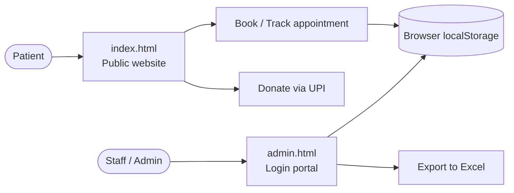

<div align="center">


# 🏥 Uni Health Center

**A friendly, mobile-first website for The Uni Clinic, Phagwara.**
Book appointments, track them, donate by UPI, and let staff manage everything from one portal.


[🌐 Live Site](https://YOUR-USERNAME.github.io/uni-health-center/) ·
[🔐 Staff Portal](https://YOUR-USERNAME.github.io/uni-health-center/admin.html) ·
[🐞 Report a Bug](../../issues/new?template=bug_report.md) ·
[💡 Request a Feature](../../issues/new?template=feature_request.md)

<br/>


</div>

---

## ✨ What can it do?

| For patients 🧑‍🤝‍🧑 | For staff & admins 🩺 |
|---|---|
| 📅 Book an appointment online | 🔑 Login with roles (admin / staff) |
| 🔎 Track a booking with its ID | 📋 View and manage all bookings |
| 👩‍⚕️ Meet the doctors & browse services | 👥 Create users, reset passwords, delete accounts |
| 💚 Donate or pay via UPI, GPay or PhonePe | 📊 Export records to Excel in one click |
| 🎉 Celebrate with a confetti confirmation | 📱 Works on phone, tablet and desktop |

## 🗺️ How it fits together



## 🚀 Quick start

```bash
git clone https://github.com/YOUR-USERNAME/uni-health-center.git
cd uni-health-center
# no build step, just open the page:
open index.html        # macOS  (Windows: start index.html)
```

## 🌍 Go live in 2 minutes (GitHub Pages)

1. Open **Settings → Pages** in your repo.
2. Under **Build and deployment**, set **Source** to **GitHub Actions**. The included workflow deploys automatically on every push to `main`.
   Prefer the simple way? Choose **Deploy from a branch → `main` → `/ (root)`** instead.
3. Wait a minute, then visit `https://YOUR-USERNAME.github.io/uni-health-center/`.

## 📁 Project structure

```text
uni-health-center/
├── index.html          # public website
├── admin.html          # staff & admin portal
├── doctors.png         # (add) team photo shown in the hero section
├── assets/
│   ├── banner.svg      # README banner
│   └── preview.png     # website preview
├── .github/            # Pages deploy workflow + issue / PR templates
├── LICENSE
├── CONTRIBUTING.md
└── SECURITY.md
```

## 🧰 Built with

- **HTML, CSS and vanilla JavaScript**, with no framework and no build step
- [Plus Jakarta Sans](https://fonts.google.com/specimen/Plus+Jakarta+Sans) typography
- [canvas-confetti](https://github.com/catdad/canvas-confetti) for celebration effects
- [SheetJS](https://sheetjs.com/) for Excel export

## ⚠️ Read this before real use

- Bookings and users are saved in each visitor's **own browser** (`localStorage`). They are **not shared** between devices.
- The default admin login is written in the source code. **Change it**, and do not treat it as real security.
- Do not store real patient data with this setup. See [SECURITY.md](SECURITY.md).

## 🛣️ Roadmap

- [x] Responsive public website
- [x] Booking and tracking
- [x] UPI, GPay and PhonePe payment buttons
- [x] Staff and admin portal with Excel export
- [ ] Shared database (Firebase or Supabase) so bookings appear on every device
- [ ] Real authentication for staff
- [ ] SMS / WhatsApp appointment reminders
- [ ] Hindi and Punjabi language toggle

## 🤝 Contributing

Ideas and fixes are welcome. Read [CONTRIBUTING.md](CONTRIBUTING.md) and open a pull request.

## 📄 License

Released under the [MIT License](LICENSE).

<div align="center">

Made with 💙 for the Uni community · Phagwara, Punjab

</div>
