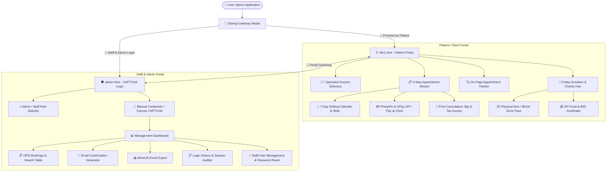

<div align="center">

# 🏥 The Uni Clinic

### ─── *Where Campus Meets Care* ───

<br>

[](https://developer.mozilla.org/en-US/docs/Web/HTML)
[](https://developer.mozilla.org/en-US/docs/Web/CSS)
[](https://developer.mozilla.org/en-US/docs/Web/JavaScript)
[](#)
[](https://sheetjs.com/)
[](#-license)

<br>

**A full-featured, zero-dependency university health center management system**
**built entirely with vanilla web technologies.**

*No React. No Angular. No backend server. Just pure HTML, CSS & JavaScript magic.* ✨

<br>

`📍 1.3 km from Central Campus` · `📞 0182 451 7000` · `🕐 OPD: 9 AM – 9 PM, Mon–Sun`

---

</div>

<br>

## 🎯 What Is This?

**The Uni Clinic** is a complete digital healthcare portal designed for **Lovely Professional University's campus health center** in Phagwara, Punjab. It serves **15,000+ students, faculty, and local residents** with a seamless experience — from booking specialist consultations to generating tax invoices to running Friday charity donation drives.

> 💡 **Zero infrastructure required.** Open `file1.html` in any modern browser and the entire system is ready. All data persists locally via `localStorage` — no database, no API keys, no server setup.

<br>

## ⚡ Quick Start

```bash
# 1. Clone
git clone https://github.com/your-username/the-uni-clinic.git
cd the-uni-clinic

# 2. Launch — that's it!
open file1.html        # macOS
start file1.html       # Windows
xdg-open file1.html   # Linux
```

Or right-click `file1.html` → **"Open with Live Server"** in VS Code for hot reload.

<br>

---

<br>

## 🧭 Table of Contents

<details>
<summary><b>Click to expand full navigation</b></summary>

<br>

| # | Section | Description |
|:---:|:---|:---|
| 01 | [✨ Feature Highlights](#-feature-highlights) | What makes this project stand out |
| 02 | [🏗️ System Architecture](#️-system-architecture) | Visual flowchart of the entire system |
| 03 | [🩺 Patient Portal Deep Dive](#-patient-portal-deep-dive) | Every feature of `file1.html` explained |
| 04 | [🔐 Admin Portal Deep Dive](#-admin-portal-deep-dive) | Every feature of `admin.html` explained |
| 05 | [🎨 UI & Design System](#-ui--design-system) | Navigation, responsiveness, animations |
| 06 | [🔑 Login Credentials](#-login-credentials) | Default accounts and access levels |
| 07 | [📁 Project Structure](#-project-structure) | File tree and responsibilities |
| 08 | [🛡️ Security Mechanisms](#️-security-mechanisms) | CAPTCHA, hashing, validation |
| 09 | [🛠️ Tech Stack](#️-tech-stack) | Technologies used |
| 10 | [📍 Contact & Location](#-contact--location) | How to reach the clinic |
| 11 | [📄 License](#-license) | MIT License details |

</details>

<br>

---

<br>

## ✨ Feature Highlights

<div align="center">

| 🩺 Patient Side | 🔐 Admin Side |
|:---|:---|
| 🧑‍⚕️ 6 Specialist Doctors Directory | 🛡️ Canvas CAPTCHA Anti-Bot Login |
| 📅 4-Step Booking Wizard | 📊 OPD Booking Dashboard |
| 💳 PhonePe & GPay UPI Deep Linking | 📧 One-Click Email Confirmations |
| 🧾 Printable Slips & Tax Invoices | 📥 Excel Export via SheetJS |
| 🔍 Appointment Tracker | 📋 Login Audit Trail |
| 🎁 Friday Donation Drive & 80G Certs | 👥 Staff Account Management |
| 📱 Mobile-First Responsive Design | 🔒 SHA-256 Password Hashing |
| 🌟 Startup Gateway Portal Modal | ⚡ Dual Admin/Staff Role Switching |

</div>

<br>

---

<br>

## 🏗️ System Architecture



<br>

---

<br>

## 🩺 Patient Portal Deep Dive

> **`file1.html`** — The heart of the system. A single-file SPA weighing ~207 KB of pure craftsmanship.

<br>

### 🚪 Startup Gateway Modal

When the application loads, a **portal selection modal** automatically appears, giving visitors a clear choice:

| Option | Destination |
|:---|:---|
| 👤 **Client / Patient Site** | Continues to the full patient portal |
| 🔐 **Staff & Admin Login** | Redirects to `admin.html` |

> The gateway is also accessible anytime via **footer portal links**.

<br>

### 👨‍⚕️ Specialist Doctors Directory

Browse **6 certified board specialists** across multiple disciplines:

| Specialty | What's Covered |
|:---|:---|
| 🏥 General Medicine | Fever, infections, chronic illness, wellness checkups |
| 👶 Pediatrics | Child healthcare, vaccinations, growth monitoring |
| 🧴 Dermatology | Skin conditions, allergies, cosmetic consultations |
| 🦷 Dental Care | Cleanings, fillings, orthodontics, oral surgery |

**Smart Filtering**: Specialty chips (`All`, `General Physician`, `Pediatrician`, `Dermatologist`, `Dentist`) + instant text search across names and qualifications.

<br>

### 📅 4-Step Booking Wizard

A guided stepper flow that takes patients from doctor selection to confirmed appointment:

```
┌─────────────┐    ┌──────────────┐    ┌─────────────────┐    ┌──────────────┐
│  Step 1      │    │  Step 2       │    │  Step 3          │    │  Step 4       │
│  Select      │ ➜  │  Date &       │ ➜  │  Details &       │ ➜  │  Confirmation │
│  Doctor      │    │  Time Slot    │    │  Payment         │    │  & Receipt    │
└─────────────┘    └──────────────┘    └─────────────────┘    └──────────────┘
```

- **Step 2** → 7-day rolling calendar with Morning / Afternoon / Evening slot groups
- **Step 3** → Patient details (name, age, phone, email, symptoms) + payment selection
- **Step 4** → Real-time summary with unique `REF-XXXXX` reference code

<br>

### 💳 Dual Payment System

<table>
<tr>
<td width="50%">

**📱 Direct UPI Deep Linking**

- **PhonePe** → `phonepe://` app deep link
- **Google Pay** → `gpay://` app deep link
- Pre-filled with exact consultation fee
- Verified UPI ID: `7906831490@superyes`
- One-click copy UPI ID button

</td>
<td width="50%">

**🏥 Pay at Clinic**

- Cash or card at reception
- Payment status badge on slip
- No upfront digital payment required

</td>
</tr>
</table>

<br>

### 🧾 Print-Ready Documents

- **Consultation Slip** — Official appointment confirmation formatted for `Ctrl + P`
- **Tax Invoice** — Itemized breakdown with SAC codes, clinic address, and payment status

<br>

### 🔍 Appointment Tracker

Search your booking instantly — no login required:

- 🔢 Search by **10-digit mobile number**
- 🔑 Search by **unique booking reference code** (`REF-XXXXX`)
- View: confirmed date, time slot, assigned doctor, fee, and status

<br>

### 🎁 Friday Donation & Charity Hub

Every Friday, the clinic runs a humanitarian drive with **two participation paths**:

<table>
<tr>
<td width="50%">

**📦 Physical Donation Pass**

Schedule drop-offs for:
- 💊 Medicines & medical supplies
- 🧥 Warm clothing
- 🩸 Blood donations

Generates a **printable entry pass** with QR token.

</td>
<td width="50%">

**💰 Online Healthcare Fund**

- Quick-amount chips: ₹100 → ₹2,500
- Direct UPI payment
- Instant **80G Humanitarian Honor Certificate**
- Tax-deductible donation receipt

</td>
</tr>
</table>

<br>

---

<br>

## 🔐 Admin Portal Deep Dive

> **`admin.html`** — The secure back office. Protected by canvas-rendered CAPTCHA that bots can't crack.

<br>

### 🛡️ CAPTCHA-Protected Login

```
┌──────────────────────────────────────────┐
│  ┌──────────┐  ┌──────────┐              │
│  │ ⚡ Admin  │  │ 🩺 Staff  │  ← Role Tabs │
│  └──────────┘  └──────────┘              │
│                                          │
│  Username:  [ admin_____________ ]       │
│  Password:  [ ●●●●●●●●●●●  👁️  ]       │
│                                          │
│  CAPTCHA:   ╔═══════════════════╗        │
│             ║  x7Kp2            ║ ← Canvas│
│             ╚═══════════════════╝        │
│  Enter:     [ _________________ ]        │
│                                          │
│        [ 🔐 Login Securely ]             │
└──────────────────────────────────────────┘
```

**Security features:**
- 5-character alphanumeric CAPTCHA drawn on `<canvas>` with distortion, strike-throughs, rotation, and noise dots
- Password visibility toggle (`👁️` / `🙈`)
- Fresh CAPTCHA generated on every role switch
- No automated credential injection possible

<br>

### 📊 Management Dashboard

Once authenticated, admins and staff get access to:

| Module | Admin | Staff | Description |
|:---|:---:|:---:|:---|
| 📋 OPD Bookings Table | ✅ | ✅ | Search, view, delete bookings |
| 📧 Email Confirmation | ✅ | ✅ | Pre-filled `mailto:` composer |
| 📥 Excel Export | ✅ | ✅ | One-click `.xlsx` download via SheetJS |
| 📋 Login Audit Trail | ✅ | ❌ | Session timestamps, durations, exit reasons |
| 👥 Staff Management | ✅ | ❌ | Add/delete accounts, reset passwords |

<br>

### 📋 Login Audit System

The system tracks every session with forensic detail:

- ⏱️ Login timestamp & exit timestamp
- ⏳ Active session duration
- 🚪 Exit reason: Clean logout vs. tab/browser closed
- 💓 Real-time heartbeat updating activity every **20 seconds**
- 📥 Filterable by user account with Excel export

<br>

### 👥 Staff Account Management

> Admin-only. Manage the team with full CRUD operations.

- ➕ Add new staff accounts with assigned privileges
- 🔐 Passwords hashed with **salt + SHA-256** (with fallback)
- 🔄 Password reset functionality
- 🗑️ Account deletion with safety check — **at least one admin must always remain**

<br>

---

<br>

## 🎨 UI & Design System

### 🧭 Navigation Architecture

<table>
<tr>
<td width="60%">

**Desktop (> 1180px)**

- **Floating Curvy Island Navbar** with `border-radius: clamp(20px, 2.5vw, 28px)`
- Glassmorphic `backdrop-filter` blur effect
- **8 Glowing-Box Nav Links** with cyan active glow:
  ```
  box-shadow: 0 0 12px rgba(2, 132, 199, 0.45)
  ```
- Dynamic **ScrollSpy** routing for active link tracking
- Compact adaptation at `< 1400px`

</td>
<td width="40%">

**Mobile (≤ 1180px)**

- **☰ Hamburger** three-line toggle
- **Slide-out drawer** with all 8 links
- Touch-friendly tap targets
- Direct **📅 Book Appointment** action button
- Persistent **floating tracking button**

</td>
</tr>
</table>

### 🎯 Top Announcement Strip

> Centered banner showing:
> `📍 Phagwara, Punjab` · `🕐 OPD: 9 AM – 9 PM` · `📞 0182 451 7000` · `🎁 Friday Charity Drive`

### 🖼️ Hero Section

Clean two-column layout:
- **Left** → Specialist team photo with navy accent ribbon + `⭐ 4.9/5.0` floating trust card
- **Right** → Location pill, bold heading, subtitle, and two CTA buttons

<br>

---

<br>

## 🔑 Login Credentials

> [!IMPORTANT]
> All credentials **must be manually typed** — the Canvas CAPTCHA blocks any automated input.

| Role | Username | Password | Access Level |
|:---:|:---:|:---:|:---|
| 🔴 **Administrator** | `admin` | `Clinic@2026` | Full access: Bookings, Audit Logs, Staff Management, Excel Export |
| 🟢 **OPD Staff** | `staff` | `Clinic@2026` | Operational: View & manage bookings, send email confirmations |

<br>

---

<br>

## 📁 Project Structure

```
the-uni-clinic/
│
├── 🩺 file1.html          →  Patient Portal (Single-File SPA, ~207 KB)
│                              Booking wizard, doctor directory, tracker,
│                              donation hub, UPI payments, printable slips
│
├── 🔐 admin.html           →  Admin & Staff Portal (~36 KB)
│                              CAPTCHA login, OPD management, audit logs,
│                              Excel export, staff account CRUD
│
├── 🖼️ doctors.png          →  Hero section team photograph
│
├── 📱 upi-qr.jpg           →  UPI QR code for donation payments
│
└── 📄 README.md            →  You are here! 👋
```

<br>

---

<br>

## 🛡️ Security Mechanisms

<table>
<tr>
<td>

### 🎨 Canvas CAPTCHA
5-character alphanumeric code rendered on `<canvas>` with:
- Random character rotation
- Glowing text effects
- Strike-through interference lines
- Security noise dots
- Fresh generation on every attempt

</td>
<td>

### 🔐 Password Hashing
Staff passwords are secured with:
- **Cryptographic salt** generation
- **SHA-256** hash algorithm
- Graceful fallback mechanism
- Stored in `localStorage` as hashed values

</td>
</tr>
<tr>
<td>

### ✅ Input Validation
Strict client-side validation:
- 10-digit Indian mobile: `/^[6-9]\d{9}$/`
- Email format validation
- Character escaping against XSS
- Required field enforcement

</td>
<td>

### 💾 Data Isolation
Three dedicated `localStorage` keys:
- `cliniccare_bookings_v1` → Appointments
- `cliniccare_users_v1` → Staff accounts
- `cliniccare_authlog_v1` → Login audit trail

</td>
</tr>
</table>

<br>

---

<br>

## 🛠️ Tech Stack

<div align="center">

| Layer | Technology | Purpose |
|:---:|:---|:---|
| 📄 | **HTML5** | Semantic structure, Canvas API, Web Storage |
| 🎨 | **CSS3** | Glassmorphism, animations, responsive design, grid & flexbox |
| ⚡ | **Vanilla JavaScript** | DOM manipulation, stepper logic, ScrollSpy, localStorage |
| 📊 | **SheetJS** | Client-side Excel (.xlsx) file generation & export |
| 💳 | **UPI Deep Linking** | PhonePe & GPay native app integration |
| 🖨️ | **Print CSS** | Browser-native `Ctrl+P` formatted consultation slips |

</div>

> [!NOTE]
> **Zero external frameworks.** No React, Vue, Angular, Tailwind, or Bootstrap.
> Everything is hand-crafted with vanilla web technologies.

<br>

---

<br>

## 📍 Contact & Location

<div align="center">

| | Detail |
|:---:|:---|
| 🏥 | **Uni Health Center · The Uni Clinic** |
| 📍 | **1.3 km** from Central Campus, Phagwara, Punjab, India |
| 📞 | **Helpline**: `0182 451 7000` |
| 🕐 | **OPD**: Monday – Sunday, 9:00 AM – 9:00 PM |
| 🚑 | **Emergency First Aid**: Open **24/7** |

</div>

<br>

---

<br>

## 📄 License

<div align="center">

This project is licensed under the **MIT License**.

Free to use, modify, and distribute for educational, institutional, or healthcare purposes.

<br>

---

<br>

**Built with ❤️ for the campus community.**

*Compassionate Care for Our University & Local Community.*

<br>

⭐ **Star this repo** if you found it useful!

</div>
